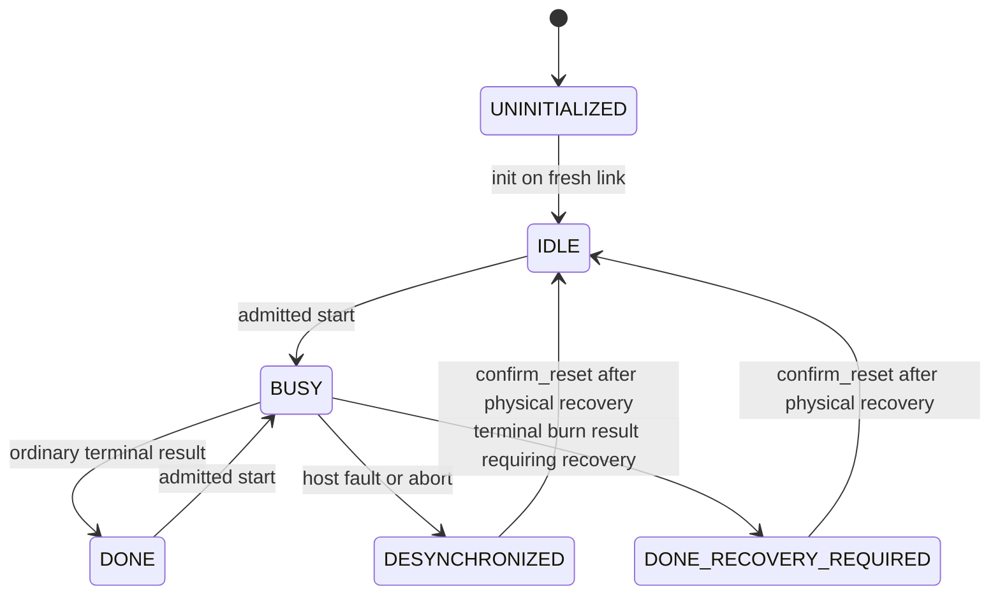

# Architecture

[User guide](../README.md) · [Capabilities](../FEATURES.md) ·
[ADR-0001](adr/0001-as608-driver-architecture.md)

## Layer boundaries

| Layer | Files in src/ | Owns |
| --- | --- | --- |
| Command | as608.c, as608.h | Admission, command phases, ACK semantics, outputs, quarantine |
| Transaction | as608_transaction.c/.h | Configuration, whole-job deadline, frame storage, partial I/O |
| Packet | as608_packet.c/.h | Big-endian header codec and additive checksum |
| Port | as608_port.h | Callback contract; implementation owned by application |
| Types | as608_types.h | Shared status and constants |

Dependency direction: command -> transaction -> packet and port -> common
types. The codec does not depend on port or transaction. The port does
not depend on codec. No lower layer includes the command layer.

The public context embeds the transport by value. Internal entry points
are not application APIs. Exposed context members allow static allocation;
they do not grant permission to modify state or depend on ABI layout.

## Job lifecycle



Only IDLE and DONE admit new jobs. A rejected admission does not replace
an active job. DONE exposes a terminal result, which may be a negative
sensor ACK. DESYNCHRONIZED exposes a host error. The burn recovery state
exposes a terminal sensor result but blocks further starts. Initialization
cannot bypass quarantine. Result snapshots are read without advancing
the job and remain available until a later successful admission or reset.

## Wire state machine

```text
IDLE -- send() -------> TX -----------> SENT -----> IDLE
IDLE -- receive() ----> RX_HEADER -----> RX_BODY -> RECEIVED -> IDLE
IDLE -- drain() ------> TX_DRAIN -----> DRAINED --> IDLE
Any active wire phase -- fault/timeout ----------> FAULT --> IDLE
```

These are transport states, independent of the command lifecycle.
The command layer schedules the next wire phase or terminates the job.
On transport fault it quarantines the context; wire IDLE does not imply
that the physical link is safe or the public context may start another job.

- TX validates counters before pointer arithmetic; accepts one prefix.
- RX_HEADER accumulates nine bytes, then validates structure, exact
  address, permitted direction, storage and caller limit.
- RX_BODY receives payload plus checksum; only complete verified
  frames produce RECEIVED.
- TX_DRAIN polls the port's physical completion condition.
- SENT denotes acceptance by the port, not physical completion.

## Cooperative scheduling and deadline

A successful start prepares the first command, samples the clock once,
and sets BUSY; it does not call UART or stream callbacks. Each normal
active process call samples the clock once and invokes at most one UART
callback. A received fragment can also invoke its sink. Source-wait and
paced enrollment-wait phases use their own cooperative paths; no UART
wait loop is executed. An invalid private step may fail before any
clock read. Terminal or idle calls perform no I/O.

Elapsed time is unsigned modulo 2^32: elapsed = now - started_ms.
Expiration is elapsed >= timeout_ms. The budget is 1..0x7FFFFFFF ms;
all composite phases share the original tick. The check precedes I/O.
A callback must return in bounded time; the deadline cannot preempt it.
A stalled scheduler can delay observation of expiration, and a full
clock wrap can hide elapsed time. This is not a hard real-time guarantee.

## Memory and ownership

| Fixed transport storage | Bytes |
| --- | ---: |
| TX frame | 267 |
| RX header | 9 |
| RX body (payload + checksum) | 258 |
| Total raw arrays | 534 |

This is not sizeof(as608_transaction_t): counters, config, padding and
command state add storage. Device-info staging adds 32 bytes to the
command context. Source polling uses a packet-sized local buffer; actual
peak stack includes callers, compiler-generated frames and interrupts.
No image-sized internal allocation or dynamic allocation is used.

TX frame preparation copies external caller data. Download Image and Burn
Code stream sources instead fill the idle TX payload view directly; the
transport encodes the header and checksum without copying that payload.
The view is borrowed only during the callback and never while a transport
phase is active. Accepted TX bytes belong to
the port. RX views borrow context storage and expire before the next
receive or reset. Stream callbacks borrow buffers only for their call.
Caller-owned output, immutable input and referenced user state follow
the public API lifetime rules. No concurrent operations on one context;
separate contexts may progress independently with exclusive physical streams.

Do not log raw buffers or assume secure erasure. The driver may retain
credentials and biometric data after completion. A successful logical
abort permits release of job-owned application buffers but not destruction
of port resources while outstanding hardware activity remains.

## Maintenance conventions

Keep one named opcode enum at the top of as608.c, private step/layout
constants grouped, and as608_process() after its handlers. Every static
function has a short English purpose comment; avoid single-use wrappers
unless they provide a meaningful abstraction. Add wire-vector and error
regressions for behavior changes. Update contracts and capabilities
together. See [testing](TESTING.md).

The reference Cortex-M3 build measured 712 bytes per context and 7241
bytes of allocated Flash sections (GCC 13.2.1, -Os); see [memory evidence](TESTING.md#arm-memory-reports).
Worst-case stack and service latency remain unmeasured.
Do not replace independent TX/RX storage or change enum ABI options
without auditing lifetimes and measuring the target build.
